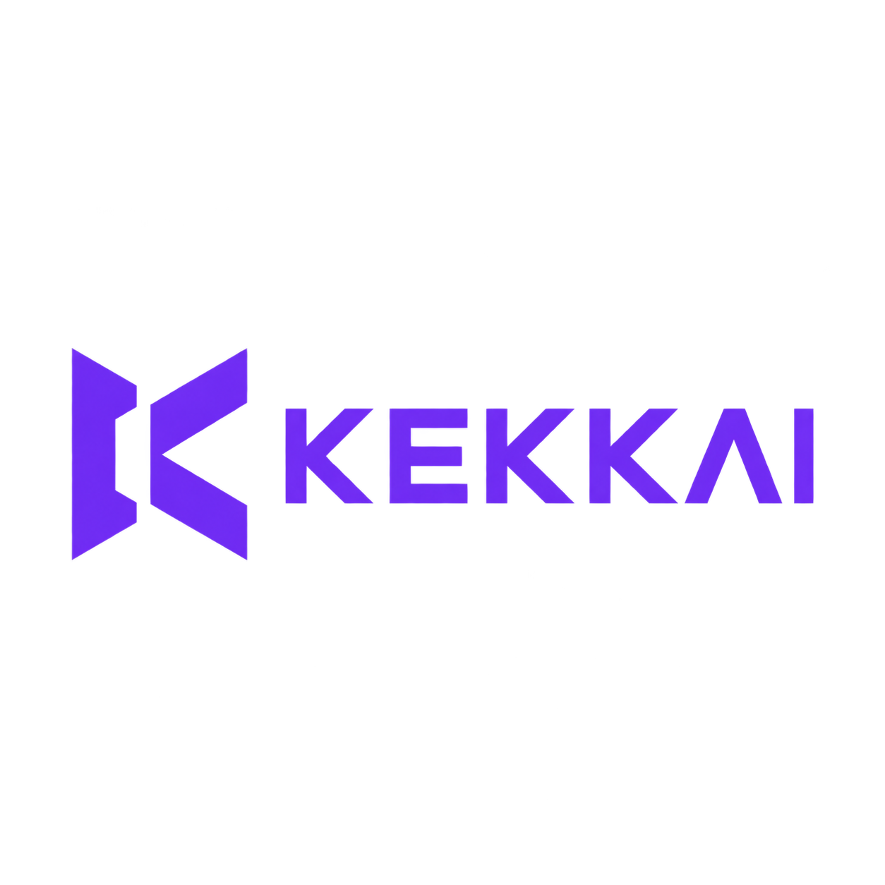

# Kekkai

<p align="center">
  
</p>

**Um workspace local de segurança para código, dependências, secrets, regras YARA e aplicações web.**

[English](README.md) · [Português (Brasil)](README.pt-BR.md) · [Licença MIT](LICENSE)

Criado por **Thayner Kesley**. O Kekkai reúne ferramentas independentes em uma aplicação desktop com PySide6. Aplica suas policies, preserva resultados parciais úteis e gera uma dashboard HTML offline. Findings são sinais para investigação; um scan aprovado não comprova que o software é seguro.

## Vídeo de uso

[](https://youtu.be/AUUMhQsUFSQ)

[Assista à demonstração de uso no YouTube](https://youtu.be/AUUMhQsUFSQ).

## Funcionalidades

| Verificação | Motor | Finalidade |
| --- | --- | --- |
| Análise estática | Semgrep CE | Patterns de código e findings de segurança |
| Secrets | Gitleaks | Credenciais expostas, com regras configuráveis |
| Composição de software | Trivy | Vulnerabilidades de dependências e indicadores de licença |
| YARA Rules | YARA-X | Regras Forge/customizadas de detecção e threat hunting |
| OWASP Top 10 | Semgrep Registry | Findings mapeados para uma edição disponível do OWASP |
| Aplicação web local | OWASP ZAP baseline | Verificações dinâmicas em um alvo local em execução |
| Revisão opcional por IA | OpenAI, Anthropic, DeepSeek, Qwen | Revisão estruturada com consentimento e validação manual |

O desktop oferece seleção de projetos, perfis quick/full, policies, progresso, cancelamento, histórico/exportação/exclusão de relatórios, gerenciador YARA, temas claro/escuro e interfaces em português e inglês. O Kekkai oferece apenas interface gráfica desktop.

## Requisitos

- Python **3.11+**, `pip` e ambiente virtual. A validação de desenvolvimento utiliza Python 3.13 no Windows.
- Docker com containers Linux para Semgrep, Gitleaks, Trivy, OWASP e ZAP. No Windows, utilize Docker Desktop com engine Linux/WSL2.
- YARA-X roda nativamente pelo pacote Python; a biblioteca gerenciada requer `yara-x >=1.21,<2`.
- PySide6/Qt WebEngine é instalado por `requirements.txt`. No Linux podem ser necessárias dependências de plataforma do Qt.
- Internet para os primeiros downloads de dependências, imagens, bases, regras e para chamadas de IA. A dashboard salva e a última biblioteca YARA validada funcionam offline. Os demais scanners dependem de seus próprios caches e serviços.

O aplicativo utiliza o executável Docker instalado e imagens de terceiros: `semgrep/semgrep:latest`, `zricethezav/gitleaks:latest`, `aquasec/trivy:latest` e `ghcr.io/zaproxy/zaproxy:stable`. Essas tags podem mudar independentemente do Kekkai.

## Instalar e iniciar

Windows / PowerShell:

```powershell
git clone https://github.com/ThaynerKesley/kekkai.git
Set-Location kekkai
python -m venv .venv
.\.venv\Scripts\python.exe -m pip install -r requirements.txt
.\.venv\Scripts\python.exe kekkai.py --language pt_BR
```

Para iniciar sem janela de console no Windows, utilize `.\.venv\Scripts\pythonw.exe -m kekkai`.

Para abrir diretamente um projeto:

```powershell
.\.venv\Scripts\python.exe kekkai.py C:\caminho\do\projeto --language pt_BR
```

Linux desktop / WSL com suporte a aplicações gráficas:

```bash
git clone https://github.com/ThaynerKesley/kekkai.git
cd kekkai
python3 -m venv .venv
.venv/bin/python -m pip install -r requirements.txt
docker info
.venv/bin/python -m kekkai --language pt_BR
```

O aplicativo abre uma janela desktop. As dependências vulneráveis e credenciais fictícias dos testes são criadas em projetos temporários isolados.

## Selecionar idioma

```powershell
python kekkai.py --language pt_BR
python kekkai.py --language en
python -m kekkai --language en
```

Também é possível salvar o idioma em **Configurações → Idioma**. Reinicie o Kekkai para aplicar a mudança. Português permanece como padrão de compatibilidade; a dashboard gerada usa o idioma ativo. Nomes de projetos, paths, chaves/status de máquina, metadados de regras e texto externo dos findings preservam seus valores/idiomas originais.

O pacote do aplicativo é `kekkai`. Tanto `python kekkai.py` quanto `python -m kekkai` abrem a mesma GUI. A inicialização aceita um diretório de projeto opcional e o idioma. Scanners, perfis, consentimento da IA e relatórios são controlados pela interface.

## Primeiro scan

1. Abra o projeto no desktop e escolha **Código local / não web** ou **Aplicação web**. Projetos importados sem essa informação solicitam a escolha.
2. Revise **Scanners**, exclusões e policies. Projetos novos no desktop começam com verificações estáticas; um YAML existente tem precedência.
3. Instale o **Core** em **YARA Rules**, ou importe suas regras, e habilite o scanner YARA quando desejar.
4. Use **Quick scan** ou **Full scan** na visão geral para abrir a aba Scan com esse perfil. Termine de configurar o projeto e os scanners e clique em **START**. Esses atalhos nunca iniciam a análise. IA sempre exige solicitação e confirmação separadas.
5. Analise findings, cobertura parcial e diagnósticos. Salve explicitamente a configuração do projeto para gravá-la no YAML.

Use **Salvar configuração** na GUI para gravar `.kekkai.yml` dentro do projeto selecionado. Para preparar uma configuração, copie o exemplo revisado:

```powershell
Copy-Item .kekkai.example.yml C:\caminho\do\projeto\.kekkai.yml
```

O exemplo completo está em [`.kekkai.example.yml`](.kekkai.example.yml). Nunca coloque API keys no YAML do projeto.

### Perfis e resultados

- **Quick:** desativa ZAP, IA e análise completa de licenças; mantém as outras verificações estáticas configuradas.
- **Full:** executa os scanners habilitados. A GUI solicita e confirma a revisão opcional por IA; `ai.enabled` sozinho nunca envia source.
- Os estados internos são `pass`, `warn`, `fail`, `error` e `skipped`. Verificações finalizadas aparecem como **COMPLETED**; erros técnicos e cobertura parcial ficam em **Diagnóstico**. Verificações puladas permanecem **SKIPPED**. Os status internos e o bloqueio da policy são preservados.
- O resultado geral é `approved`, `blocked` por policy ou `error` técnico. Erros técnicos têm precedência. Avisos e verificações puladas não bloqueiam sozinhos. Esses resultados pertencem ao relatório; fechar a GUI não retorna um código de resultado do scan.
- Uma falha não cancela os demais scanners. Warnings isolados de parsing preservam findings disponíveis e indicam cobertura parcial. Considere verificações parciais/puladas ao interpretar uma aprovação.

Projetos recentes podem ser removidos em **Projetos → Remover dos recentes**. A ação altera apenas a lista local de atalhos; remover o projeto ativo mantém ele aberto e preserva seus arquivos e relatórios.

## Configuração

O YAML controla tipo de projeto, exclusões relativas literais, scanners, severidades, limites YARA, edição OWASP, alvo ZAP, limites da IA, paralelismo, relatórios e cache Trivy. Nomes simples de pastas nas exclusões valem em qualquer profundidade; paths são literais, sem globs de shell.

SCA separa **Version Risk** e **Licensing**. Deny, allowlist não vazia e classificações bloqueantes são cumulativas. Resultados de licença indicam risco e dependem do contexto; não são parecer jurídico. Configurações antigas de `policy.trivy` migram para SCA preservando o comportamento anterior.

Scanners independentes utilizam até `performance.max_workers` workers: 1–8, padrão 3. IA executa depois da verificação de secrets para excluir arquivos sinalizados. Cancelar encerra containers pertencentes à execução; downloads ou chamadas HTTP podem precisar atingir seu timeout. O último relatório completo é preservado quando o cancelamento ocorre antes da persistência.

## Gerenciador YARA

**YARA Rules** utiliza as [releases oficiais do YARA Forge](https://github.com/YARAHQ/yara-forge/releases). **Core** é o pacote padrão. **Extended** e **Full** são opções avançadas, com maior consumo e possibilidade de falsos positivos. As regras mantêm licenças e origens próprias; o download não as relicencia como MIT.

O gerenciador oferece:

- SHA-256 oficial, limites de download/descompactação e validação nativa em staging antes da ativação.
- Contagem de regras válidas, inválidas e ativas; nomes, tags, autor, licença, origem, versão e diagnósticos seguros de compatibilidade. Regras privadas de suporte contam como válidas, mas não como detecções ativas.
- Importação de `.yar`/`.yara` com expansão de includes contidos no diretório autorizado. Traversal, includes cíclicos/externos e módulos incompatíveis são recusados ou isolados. Regras inválidas e dependentes afetadas nunca são ativadas.
- Atualização manual ou automática configurável antes dos scans, histórico imutável, desativação de biblioteca/regra, revalidação e rollback.
- Uso offline da última fonte validada. Hashes das fontes e versão do motor são conferidos no carregamento. As regras nativas são compiladas em memória e mantidas em cache durante o processo; não é necessário um binário de assinaturas no disco. Atualizar o motor exige revalidar a biblioteca.

A validação usa um processo filho com timeout de 120 segundos e limite de memória de 2 GiB. Os padrões do scan são 50 MiB por arquivo, 10 segundos por arquivo, 300 segundos totais e 1.024 MiB de entrada analisada. Atingir limites preserva matches válidos e marca o resultado parcial. Validação/compilação e I/O acrescentam tempo fora do cronômetro agregado do scan. Os relatórios não incluem os bytes dos matches.

Exemplo inofensivo de regra personalizada:

```yara
rule Kekkai_Harmless_Test : test {
    meta:
        author = "Seu nome"
        license = "MIT"
    strings:
        $marker = "KEKKAI_HARMLESS_TEST_MARKER"
    condition:
        $marker
}
```

Importe a regra, habilite YARA e analise um arquivo de texto com o marcador. O resultado informa regra, arquivo, tags, metadados e versão da biblioteca. Match é um sinal para investigação, **não malware confirmado**. Os paths antigos de `policy.yara.rules` continuam aceitos; includes no fluxo manual direto ficam desabilitados.

## IA e estimativas de custo

Configure modelo e endpoint oficial em **AI Review**. DeepSeek usa os IDs `deepseek-v4-pro` e `deepseek-flash`; o alias de versão `DeepSeek-V4-Pro-0813` é normalizado. Qwen aceita endpoints regionais documentados e endpoints oficiais de workspace restritos. As capacidades determinam o modo JSON/schema; a validação local de schema e arquivo/linha sempre se aplica.

Cada revisão exige consentimento com lista de arquivos, tamanho aproximado, path/tamanho do guide, quantidade de requisições e estimativas de tokens/custo. Guides externos/excluídos herdados do projeto exigem seleção local explícita; guides sinalizados como contendo secrets são recusados. O padrão é [`kekkai/prompts/security.md`](kekkai/prompts/security.md). Guides externos escolhidos localmente continuam disponíveis e aparecem na confirmação.

Cada chamada contém o guide e o grupo atual de source, sem histórico de conversa nem respostas anteriores. Arquivos sensíveis conhecidos, exclusões, arquivos detectados com secrets e arquivos acima dos limites são omitidos. Respostas truncadas/inválidas recebem tentativas limitadas: padrão de 2 por grupo, 8.192 tokens iniciais de saída e até 32.768 na tentativa seguinte. Esgotar um grupo registra o erro e permite continuar os seguintes; incompatibilidade de autenticação/configuração interrompe novas chamadas. Findings anteriores válidos são preservados; revisões incompletas continuam como erro.

O uso informado pela API é agregado, incluindo tokens disponíveis de respostas malsucedidas, cache e reasoning. Custos são **estimativas**, não registros de cobrança. Uma requisição com timeout sem usage pode ser cobrada pelo provider. A previsão de entrada usa heurística bytes/3; orçamento de saída e tentativas são configuráveis.

A tabela interna DeepSeek foi verificada em **26/10/2026**, com faixa off-peak/peak e consideração de cache. Por exemplo, 100.000 tokens de entrada sem cache e 20.000 de saída no V4 Pro estimam **US$ 0,1056–0,2112**. Consulte os [preços oficiais](https://api-docs.deepseek.com/quick_start/pricing/), que podem mudar. Outros modelos/providers podem utilizar tarifas manuais em USD por milhão de tokens na policy de IA. Não há consulta à API de conta/faturamento.

Chaves são mascaradas e ficam somente em memória por padrão. Salvar explicitamente no Windows usa **Windows Credential Manager**, sem fallback em texto puro. A configuração do provider pode ser salva separadamente. Testes de conexão enviam apenas uma mensagem mínima, sem arquivos, e podem consumir tokens. Findings de IA exigem validação manual; a retenção do conteúdo enviado depende do provider.

## Relatórios, histórico e privacidade

Saída padrão dentro do projeto:

```text
.security/
  reports/summary.json
  reports/raw/                 # Resultados reduzidos/sanitizados
  dashboard/index.html         # HTML autocontido
  history/<timestamp-id>/      # Snapshots desktop; raw fica diretamente nesta pasta
```

O desktop lista o resultado atual e o histórico. Selecione uma execução em **Relatórios** para abrir a dashboard no Kekkai ou no navegador padrão, exportar um **HTML** independente, gerar um **PDF**, abrir summary/raw, exportar ZIP ou excluir o relatório após confirmação. Excluir o atual não apaga históricos separados; excluir um snapshot preserva outras execuções, source e cache. Execuções concluídas pela GUI arquivam os resultados no histórico local.

Na aba Scan, **Abrir dashboard ao concluir** permite escolher **Kekkai** ou **Navegador**. Salve o visualizador padrão em **Configurações → Abrir relatório em**.

Os relatórios HTML/no navegador usam a dashboard Kekkai com identidade visual, gráficos, busca, filtros, agrupamento, detalhes técnicos e temas claro/escuro. O HTML é autocontido e funciona sem servidor ou internet. As ações de exportação também ficam acima da dashboard integrada. O PDF usa um layout A4 claro separado e inclui todos os findings e detalhes técnicos, independentemente dos filtros da tela. A exportação não altera a dashboard aberta. No navegador também há **Imprimir / Salvar PDF**.

Títulos, descrições, impacto e recomendações gerados pelo Kekkai acompanham o idioma selecionado, inclusive ao reabrir relatórios antigos. Mensagens originais dos scanners, identificadores e textos produzidos pela IA preservam seu idioma original; mensagens e soluções das ferramentas ficam disponíveis nos detalhes técnicos.

A sanitização remove formas conhecidas de secrets, campos de source/evidência e conteúdo correspondente quando suportado. **Relatórios ainda contêm paths de projetos, dependências, policies, endpoints e findings. Revise antes de compartilhar.** Nenhum detector garante a remoção de toda informação sensível. Regras customizadas/allowlists do Gitleaks afetam a cobertura.

O `.gitignore` permite apenas o pacote do aplicativo, testes de regressão, launcher, dependências, licença e documentação revisada. Outros arquivos na raiz ficam locais por padrão. Regras adicionais excluem YAML local, relatórios, caches, ambientes, chaves, screenshots privados e referências de design nas pastas permitidas. Somente as duas logos fornecidas fazem parte dos assets publicados. Nunca force a inclusão de artefatos ignorados ou credenciais.

O viewer integrado utiliza perfil WebEngine sem persistência e bloqueia navegação remota, popups e outros arquivos locais. O HTML temporário é removido ao fechar. O source é montado como somente leitura nos scanners, mas exclusões são instruções das ferramentas: não escondem arquivos de um container confiável como um sandbox de filesystem. A configuração auto do Semgrep pode usar seus próprios serviços de registry/metrics. Analise apenas projetos e aplicações para os quais tenha autorização.

## Alvos web e diagnóstico do ZAP

Defina `project.web: true`, habilite ZAP e inicie a aplicação antes do scan. Só são aceitos HTTP/HTTPS em localhost, `127.0.0.1` e `host.docker.internal`; credenciais, query e fragmento na URL são recusados. O Kekkai verifica acesso tanto pelo computador quanto pelo container.

No Windows, um servidor restrito a `localhost`/`::1` pode responder no computador e ficar inacessível ao Docker. Em um alvo Vite local, pode-se iniciar com `npm run dev -- --host 0.0.0.0` e permitir explicitamente o hostname Docker na allowlist local, se necessário. Isso escuta em todas as interfaces; utilize firewall/rede de desenvolvimento apropriados. O Kekkai não modifica a configuração do seu servidor. Alvos offline/não web são pulados com diagnóstico; falhas de container/relatório continuam como erros técnicos.

## Cache Trivy

- **smart:** reutiliza bases recentes, mantém scan cache em memória por padrão e limpa seletivamente dados descartáveis.
- **persistent:** preserva os caches suportados.
- **ephemeral:** utiliza armazenamento temporário descartado ao terminar.

O TTL padrão da base é 24 horas; o orçamento de limpeza é 750 MiB. Bases úteis não são apagadas automaticamente para cumprir esse orçamento. Os diretórios de cache do aplicativo são: `%LOCALAPPDATA%\Kekkai\cache\trivy` no Windows e `$XDG_CACHE_HOME/Kekkai/cache/trivy` ou `~/.cache/Kekkai/cache/trivy` no Linux.

Configure modo, TTL e limite de tamanho em **Configurações**. O modo smart limpa itens descartáveis com operações suportadas pelo Trivy, preservando bases úteis.

## Desenvolvimento e validação

```powershell
python -m pip install -r requirements.txt
python -m unittest discover -s tests -v
python -m compileall -q kekkai tests kekkai.py
```

Testes reais de Docker e da release oficial Forge são opt-in:

```powershell
$env:KEKKAI_DOCKER_TESTS = '1'
$env:KEKKAI_NETWORK_TESTS = '1'
python -m unittest discover -s tests -v
Remove-Item Env:\KEKKAI_DOCKER_TESTS
Remove-Item Env:\KEKKAI_NETWORK_TESTS
```

Os testes usam marcadores inofensivos, chamadas IA simuladas, projetos temporários e namespace isolado de cofre. Nunca exigem API keys reais. Verificações de rede/Docker consomem recursos locais e baixam dados upstream.

Arquitetura: `core/service.py` expõe a API compartilhada; `runner.py` orquestra; `scanners.py` integra ferramentas; `configuration.py` valida policies; `ai_providers.py`/`ai_review.py` implementam as fronteiras de IA stateless; `yara_library.py` gerencia regras; `core/storage.py` cuida de preferências/histórico; `gui/` apresenta telas Qt; `dashboard/` renderiza HTML offline; `themes/` compartilha tokens. Estenda esses componentes ao contribuir, mantendo testes de regressão, o fluxo desktop e os contratos de máquina. Não inclua secrets nem relatórios reais nos commits.

As preferências são armazenadas em `%LOCALAPPDATA%\Kekkai\desktop` ou `~/.local/share/Kekkai/desktop`; o namespace do cofre Windows é `Kekkai/AI`.

Em uma instalação existente, renomeie a configuração de cada projeto para `.kekkai.yml` e a pasta de regras customizadas para `.kekkai/yara/`. Cadastre novamente as API keys salvas no novo namespace Kekkai do cofre. Preferências pessoais, regras baixadas, relatórios, cache e chaves são dados locais e nunca fazem parte da distribuição do código.

## Licença e créditos

Kekkai utiliza a [licença MIT](LICENSE), copyright © 2026 Thayner Kesley. Motores de terceiros, dependências Python/Qt e bibliotecas de regras mantêm suas respectivas licenças e créditos. Os pacotes de regras Forge não são redistribuídos neste repositório.
